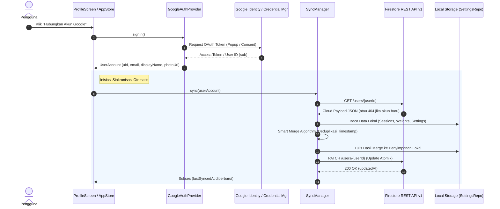

# Integrasi Otentikasi Google & Sinkronisasi Cloud Firestore

Dokumen ini menjelaskan secara menyeluruh arsitektur, konfigurasi, alur data, dan mekanisme sinkronisasi data (*cloud sync*) pada aplikasi **Heula KMP** (Kotlin Multiplatform).

---

## 1. Ikhtisar Arsitektur

Heula KMP mengadopsi prinsip **Offline-First**. Seluruh aktivitas berpuasa, catatan berat badan, dan preferensi aplikasi tersimpan secara instan di penyimpanan lokal perangkat (*local storage* / *SharedPreferences* / *NSUserDefaults* melalui `MultiplatformSettings`).

Saat pengguna menghubungkan Akun Google mereka:
1. Identitas diverifikasi melalui **Google OAuth 2.0** (Google Identity Services untuk Web, Credential Manager untuk Android).
2. Sesi berpuasa dan catatan berat badan lokal disinkronkan secara dua arah (*bidirectional smart merge*) dengan **Google Cloud Firestore**.
3. Komunikasi dengan Firestore dilakukan secara langsung via **Firestore REST API v1** menggunakan satu dokumen atomik per pengguna (`users/{userId}`), memangkas ketergantungan pada native SDK yang berat dan menghemat kuota Firebase secara optimal.



---

## 2. Alur Otentikasi Google (OAuth 2.0)

### 2.1 Web Platform (WasmJs)
- **Teknologi:** Google Identity Services (GIS) Web SDK via JavaScript interop (`@JsFun` di Kotlin Wasm).
- **Library Client:** `https://accounts.google.com/gsi/client`
- **Scope yang Digunakan:** `email`, `profile`, `openid`
- **Alur Interaksi:**
  1. Pengguna menekan tombol "Hubungkan Akun Google".
  2. GIS menampilkan jendela popup resmi Google (`prompt: 'consent'`).
  3. Setelah pengguna menyetujui, token akses diterima dan langsung memanggil endpoint profil Google:
     `https://www.googleapis.com/oauth2/v3/userinfo`
  4. Objek profil pengguna (`uid`, `email`, `displayName`, `photoUrl`) disimpan ke `localStorage` dengan kunci `heula_google_auth_result`.
  5. `WasmGoogleAuthProvider` memantau dan memparsing token tersebut ke domain model Kotlin `UserAccount`.

### 2.2 Android Platform
- **Teknologi:** Android Credential Manager API & Google Play Services Auth.
- **Provider:** `AndroidGoogleAuthProvider` terpasang melalui modul Koin platform.
- **Keamanan:** Memvalidasi tanda tangan aplikasi menggunakan SHA-1 fingerprint dari keystore pengembang.

---

## 3. Desain Database Cloud Firestore

### 3.1 Mengapa Memilih Firestore REST API?
1. **Ringan & Bebas Dependensi Wasm:** SDK Firebase native sering kali memiliki keterbatasan kompatibilitas atau kompilasi berukuran besar pada target Kotlin/Wasm. Firestore REST API menggunakan HTTP bawaan browser (`window.fetch`) di Web dan `HttpURLConnection` di Android.
2. **Efisiensi Kuota (Firebase Free Tier):**
   - Free tier Firebase menyediakan **50.000 read** dan **20.000 write** per hari.
   - Dengan menyimpan snapshot sesi dalam satu field atomik `payload`, satu siklus sinkronisasi penuh hanya menghabiskan **1 read** dan **1 write**, bukan ratusan operasi read/write per item riwayat.

### 3.2 Skema Dokumen (`users/{userId}`)

Path dokumen pada Firestore:
```text
projects/{PROJECT_ID}/databases/(default)/documents/users/{USER_ID}
```

Struktur field pada dokumen Firestore:

| Field | Tipe Firestore | Deskripsi |
| :--- | :--- | :--- |
| `email` | `stringValue` | Email akun Google pengguna (mudah dilihat di Firebase Console). |
| `displayName` | `stringValue` | Nama lengkap pengguna dari profil Google. |
| `photoUrl` | `stringValue` | URL foto profil avatar Google. |
| `updatedAt` | `integerValue` | Timestamp epoch milidetik pembaruan terakhir. |
| `payload` | `stringValue` | Serialized JSON string berisi data lengkap (`UserCloudData`). |

#### Contoh JSON Payload di dalam Dokumen:
```json
{
  "user": {
    "uid": "116901418824745298354",
    "email": "user@gmail.com",
    "displayName": "Agus Siswanto",
    "photoUrl": "https://lh3.googleusercontent.com/..."
  },
  "lastSyncedAt": 1731000000000,
  "sessions": [
    {
      "id": 1,
      "planId": "SIXTEEN_EIGHT",
      "planLabel": "16:8",
      "targetHours": 16.0,
      "startMs": 1730900000000,
      "endMs": 1730957600000,
      "durationMs": 57600000,
      "completed": true,
      "createdAt": 1730957600000,
      "mood": "ENERGIK",
      "note": "Badan terasa sangat segar!"
    }
  ],
  "weights": [
    {
      "id": 1,
      "weightKg": 68.5,
      "recordedAt": 1730900000000
    }
  ],
  "settings": {
    "onboarded": true,
    "chosenMethod": "SIXTEEN_EIGHT",
    "waterIntakeMl": 2000,
    "language": "INDONESIAN"
  }
}
```

---

## 4. Mesin Smart Merge (`SyncManager.kt`)

Saat terjadi sinkronisasi antara data perangkat lokal dan cloud (misalnya pengguna membuka aplikasi di laptop dan HP bergantian), `SyncManager` menjalankan aturan resolusi konflik cerdas:

### 4.1 Penggabungan Sesi Berpuasa (`mergeSessions`)
- **Kunci Unik:** Waktu mulai puasa (`startMs`).
- **Resolusi Konflik:**
  - Jika sesi yang sama ada di lokal dan cloud, status `completed` dianggap `true` jika salah satu sudah menyelesaikannya (`existing.completed || localS.completed`).
  - Waktu selesai diambil yang paling akhir (`maxOf(existing.endMs, localS.endMs)`).
  - Catatan teks (*note*) dan suasana hati (*mood*) dari sesi yang lebih baru / tidak kosong diprioritaskan.
  - Seluruh sesi diurutkan kembali secara kronologis menurun (*newest first*) dan ID diindeks ulang secara rapi.

### 4.2 Penggabungan Catatan Berat Badan (`mergeWeights`)
- **Kunci Unik:** Waktu pencatatan (`recordedAt`).
- Data yang memiliki timestamp sama digabungkan tanpa duplikasi.
- Seluruh riwayat ditata berurutan dari waktu paling lampau hingga terkini.

### 4.3 Penggabungan Pengaturan Aplikasi (`mergeSettings`)
- Jika aplikasi di perangkat baru belum melewati *onboarding* namun data di cloud sudah memiliki profil lengkap, data dari cloud akan diimpor agar pengguna tidak perlu mengisi ulang profiling.

---

## 5. Panduan Konfigurasi Google Cloud & Firebase

Untuk mengonfigurasi proyek baru dari awal:

### Langkah 1: Buat Project Google Cloud
1. Masuk ke [Google Cloud Console](https://console.cloud.google.com/).
2. Buat proyek baru atau gunakan proyek yang sudah ada (misalnya: `heula-514007`).
3. Catat **Project ID** Anda.

### Langkah 2: Konfigurasi OAuth Consent Screen
1. Navigasi ke **APIs & Services** > **OAuth consent screen**.
2. Pilih User Type **External**, klik Buat.
3. Masukkan Nama Aplikasi: `Heula`, Email Dukungan Pengguna, dan Kontak Developer.
4. Pada tab **Scopes**, tambahkan:
   - `.../auth/userinfo.email`
   - `.../auth/userinfo.profile`
   - `openid`
5. Jika status masih *Testing*, tambahkan email Google Anda ke daftar **Test Users**.

### Langkah 3: Buat OAuth 2.0 Client IDs
1. Buka **APIs & Services** > **Credentials** > **Create Credentials** > **OAuth client ID**.
2. **Untuk Web Application:**
   - Application type: **Web application**
   - Name: `Heula Web Client`
   - **Authorized JavaScript origins:**
     - `http://localhost:8080`
     - `http://localhost`
     - `http://127.0.0.1:8080`
     - `https://your-production-url.com`
   - Salin **Client ID** yang dihasilkan.
3. **Untuk Android Application:**
   - Application type: **Android**
   - Package name: `id.heula`
   - SHA-1 certificate fingerprint (dapatkan via `keytool -list -v -keystore ~/.android/debug.keystore`).

### Langkah 4: Aktifkan Cloud Firestore
1. Masuk ke [Firebase Console](https://console.firebase.google.com/) menggunakan akun Google yang sama.
2. Tambahkan atau pilih proyek Google Cloud yang sama (`heula-514007`).
3. Masuk ke menu **Build** > **Firestore Database**, klik **Create Database**.
4. Pilih lokasi database (misalnya: `asia-southeast2` Jakarta).
5. Pada tab **Rules**, terapkan aturan keamanan berikut:

#### Aturan Firestore untuk Mode Pengembangan / Uji Coba:
```rules
rules_version = '2';
service cloud.firestore {
  match /databases/{database}/documents {
    match /users/{userId} {
      allow read, write: if true;
    }
  }
}
```

#### Aturan Firestore untuk Mode Produksi (Terkunci Per-User):
```rules
rules_version = '2';
service cloud.firestore {
  match /databases/{database}/documents {
    match /users/{userId} {
      // Hanya izinkan baca/tulis jika token request terotentikasi dan UID cocok
      allow read, write: if request.auth != null && request.auth.uid == userId;
    }
  }
}
```

---

## 6. Penanganan Masalah & Troubleshooting

| Gejala Masalah | Penyebab Umum | Solusi |
| :--- | :--- | :--- |
| **Error 401 `invalid_client` / `origin_mismatch`** | Asal JavaScript (`http://localhost:8080`) belum didaftarkan di OAuth Client ID. | Tambahkan origin ke tab *Authorized JavaScript origins* di Google Cloud Console. |
| **Error 403 `PERMISSION_DENIED` pada Firestore** | Aturan keamanan Firestore belum mengizinkan akses ke path `/users/{userId}`. | Periksa tab *Rules* di Firestore Console dan sesuaikan dengan aturan di atas. |
| **OutOfMemoryError saat compile WasmJs** | Gradle daemon kehabisan memori saat mengompilasi Wasm & Webpack. | Pastikan `gradle.properties` memiliki baris `org.gradle.jvmargs=-Xmx4096M` dan `kotlin.daemon.jvmargs=-Xmx4096M`. |
| **Data lokal tidak muncul di cloud** | Pengguna belum menekan tombol "Sinkronkan Sekarang" atau belum login. | Status sinkronisasi dapat dipantau langsung pada kartu profil di menu Pengaturan. |
